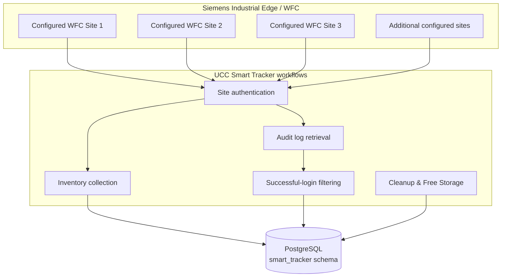
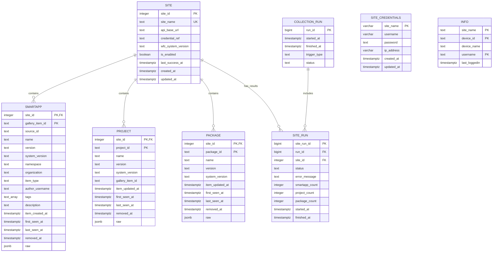

# UCC Smart Tracker

## Siemens WFC — Centralized Multi-Site Inventory & Monitoring

UCC Smart Tracker provides centralized visibility of inventory and user-login information across configured Siemens Industrial Edge Workflow Control (WFC) sites. It collects site information and WFC inventory metadata, records collection outcomes, and maintains the latest successful login information in PostgreSQL.

The solution is designed to help UCC teams answer operational questions such as:

- Which WFC sites are configured and enabled?
- Which SmartApps, projects, and packages are present at each site?
- When was an inventory item last observed?
- Which inventory items have been marked as removed?
- When did the latest collection run start and finish, and did it succeed?
- Which sites failed or were skipped during a collection?
- Which user last successfully logged in to a device, and when?

> **Scope:** This repository documents inventory and login monitoring. It does not enable WFC control commands or process write-back operations.

## Repository contents

```text
UCC-Smart-Tracker/
├── README.md
├── DATABASE.md
├── workflow/
│   ├── SmartTracker.md
│   └── CleanUp.md
└── sql/
    └── schema.sql
```

| File | Purpose |
|---|---|
| `README.md` | Project overview, architecture, embedded ER diagram, and links to the detailed documents. |
| `DATABASE.md` | Detailed explanation of every database table, column, key, relationship, constraint, index, and data lifecycle. |
| `workflow/SmartTracker.md` | Multi-site inventory and audit/login collection workflow. |
| `workflow/CleanUp.md` | Cleanup workflow, deletion behavior, transaction considerations, and operational safeguards. |
| `sql/schema.sql` | PostgreSQL schema creation script supplied for the current design. |

## 1. Solution architecture

Each configured WFC site is represented in the central `smart_tracker.site` table. The collection workflow uses site configuration and credentials to connect to WFC APIs, retrieves inventory metadata, and writes the results to PostgreSQL. It also processes audit information to update the latest successful login records.

The cleanup workflow performs database maintenance on selected inventory and collection-history records.



## 2. Database schema

PostgreSQL is the central repository. The `smart_tracker` schema contains eight tables:

| Area | Tables | What they store |
|---|---|---|
| Site configuration | `site`, `site_credentials` | Configured site endpoints and the credentials used by the workflow. |
| Inventory | `smartapp`, `project`, `package` | WFC inventory metadata, including first/last-seen and removal timestamps. |
| Collection history | `collection_run`, `site_run` | Overall run status and the result for each site in a run. |
| Login monitoring | `info` | Latest successful login timestamp for each site/device/username combination. |

### 2.1 Entity relationship diagram

The following Mermaid ER diagram is embedded in the README so GitHub can render the schema visually. It reflects the foreign keys present in `sql/schema.sql`.



**Important relationship detail:** `site` is the parent of `smartapp`, `project`, `package`, and `site_run` through `site_id`. `collection_run` is the parent of `site_run` through `run_id`. In the supplied DDL, `site_credentials.site_name` and `info.site_name` are not declared as foreign keys to `site.site_name`; they are therefore shown as standalone tables in the ER diagram. Their matching site names are maintained by application/workflow logic, not enforced by a database FK.

For the full column-by-column explanation, constraints, indexes, relationships, and example queries, see **[DATABASE.md](DATABASE.md)**.

## 3. Workflow overview

### Multi-site inventory and login monitoring

The Smart Tracker collection workflow authenticates with configured sites, collects SmartApps/projects/packages, updates the inventory tables, retrieves audit information, filters successful login events, and updates `info`. It also records overall and per-site execution results in `collection_run` and `site_run`.

See **[workflow/SmartTracker.md](workflow/SmartTracker.md)** for the detailed sequence and table mapping.

### Cleanup and free storage

The cleanup workflow is a maintenance process for removing selected obsolete inventory rows and collection execution history. Inventory rows are marked with `removed_at` during synchronization; cleanup is a separate physical-deletion step governed by the configured policy.

See **[workflow/CleanUp.md](workflow/CleanUp.md)** for the cleanup scope and safeguards.

## 4. Key data interpretation

| Data field | Interpretation |
|---|---|
| `first_seen_at` | First time the inventory item was observed by Smart Tracker. |
| `last_seen_at` | Most recent collection in which the item was observed. |
| `removed_at` | Timestamp indicating that the item was no longer found in the latest inventory synchronization. A null value means it is not marked as removed. |
| `collection_run.status` | Overall run state: `running`, `success`, `partial`, or `failed`. |
| `site_run.status` | Per-site result: `success`, `failed`, or `skipped`. |
| `info.last_loggedin` | Latest successful login timestamp stored for the site/device/username key. |

## 5. Security and operational notes

- Treat `site_credentials.password` as sensitive. Restrict database permissions and never include credential values in screenshots, logs, exports, or documentation.
- Do not commit live credentials, tokens, or site-specific secrets to this repository.
- Confirm backup and retention requirements before running cleanup in a production environment.
- Validate the deployed database constraints against `sql/schema.sql` before applying schema changes.
- The ER diagram documents database relationships; it is not a substitute for reviewing the actual deployed DDL.

## 6. Intended audience

UCC operations teams, utility/site engineers, Siemens WFC administrators, application support teams, database administrators, and developers maintaining UCC Smart Tracker.

---

**UCC Smart Tracker — Centralized inventory visibility and login monitoring across Siemens WFC environments.**
