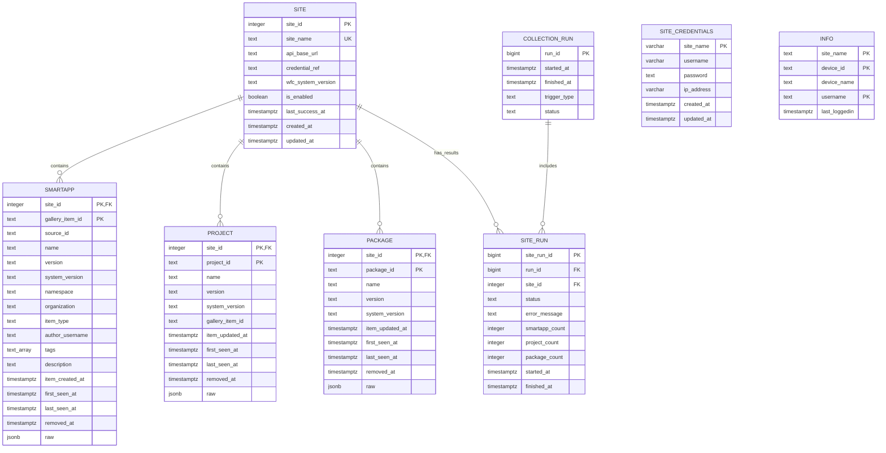

# UCC Smart Tracker — Database Architecture & Schema

## 1. Purpose

The `smart_tracker` PostgreSQL schema is the central data store for UCC Smart Tracker. It stores:

- Configured WFC sites and their connection metadata.
- Site credentials used by the collection workflow.
- SmartApp, project, and package inventory metadata.
- Overall collection runs and per-site execution results.
- Latest successful login information by site, device, and username.

The authoritative creation script for the documented design is [`sql/schema.sql`](sql/schema.sql).

## 2. Entity relationship diagram



## 3. Table relationships — what references what?

The following relationships are explicitly enforced by foreign-key constraints in the supplied DDL.

| Parent table | Parent key | Child table | Child key | Relationship |
|---|---|---|---|---|
| `site` | `site_id` | `smartapp` | `site_id` | One site can have many SmartApps. |
| `site` | `site_id` | `project` | `site_id` | One site can have many projects. |
| `site` | `site_id` | `package` | `site_id` | One site can have many packages. |
| `site` | `site_id` | `site_run` | `site_id` | One site can have many site-level run results. |
| `collection_run` | `run_id` | `site_run` | `run_id` | One collection run can include many site-level results. |

### 3.1 Relationships not enforced by foreign keys

Two tables contain `site_name`, but the supplied DDL does not define a foreign key from either table to `site.site_name`:

- `site_credentials.site_name` — intended to correspond to `site.site_name`.
- `info.site_name` — identifies the site associated with the login record.

These are logical/application-level associations in the current DDL. PostgreSQL does not currently prevent an unmatched site name from being inserted into these tables. If referential enforcement is required, add and validate suitable foreign keys after checking existing data and deployment requirements.

`site.credential_ref` is a text reference field. The supplied DDL does not declare it as a foreign key to `site_credentials`.

## 4. Table-by-table documentation

### 4.1 `site` — site configuration

**Purpose:** Parent/master table. Stores one record for each configured WFC site.

| Column | Type | Key / rule | Description |
|---|---|---|---|
| `site_id` | `SERIAL` | PK | Generated internal site identifier. |
| `site_name` | `TEXT` | NOT NULL, UNIQUE | Human-readable unique site name. |
| `api_base_url` | `TEXT` | NOT NULL | Base URL used to communicate with the WFC API. |
| `credential_ref` | `TEXT` | — | Reference used by the application/workflow to identify credentials. |
| `wfc_system_version` | `TEXT` | — | WFC system version recorded for the site. |
| `is_enabled` | `BOOLEAN` | NOT NULL, default `TRUE` | Indicates whether the site is enabled for processing. |
| `last_success_at` | `TIMESTAMPTZ` | — | Timestamp of the last successful site collection, when maintained by the workflow. |
| `created_at` | `TIMESTAMPTZ` | NOT NULL, default `NOW()` | Row creation timestamp. |
| `updated_at` | `TIMESTAMPTZ` | NOT NULL, default `NOW()` | Row update timestamp; the workflow/application must update it when required. |

**Primary key:** `site_id`  
**Unique key:** `site_name`

### 4.2 `smartapp` — SmartApp/Gallery inventory

**Purpose:** Stores SmartApp/Gallery item metadata observed at each site.

| Column | Type | Key / rule | Description |
|---|---|---|---|
| `site_id` | `INTEGER` | PK, FK → `site.site_id` | Site that owns the inventory record. |
| `gallery_item_id` | `TEXT` | PK | WFC Gallery item identifier. |
| `source_id` | `TEXT` | — | Source identifier returned by WFC, when available. |
| `name` | `TEXT` | NOT NULL | SmartApp/Gallery item name. |
| `version` | `TEXT` | — | Item version. |
| `system_version` | `TEXT` | — | Associated WFC/system version metadata. |
| `namespace` | `TEXT` | — | Namespace metadata. |
| `organization` | `TEXT` | — | Organization/publisher metadata. |
| `item_type` | `TEXT` | — | WFC item type. |
| `author_username` | `TEXT` | — | Author username, when available. |
| `tags` | `TEXT[]` | — | Array of item tags. |
| `description` | `TEXT` | — | Item description. |
| `item_created_at` | `TIMESTAMPTZ` | — | Creation timestamp reported for the item. |
| `first_seen_at` | `TIMESTAMPTZ` | NOT NULL, default `NOW()` | First time Smart Tracker observed the item. |
| `last_seen_at` | `TIMESTAMPTZ` | NOT NULL, default `NOW()` | Most recent time the item was observed. |
| `removed_at` | `TIMESTAMPTZ` | — | Set when the item is no longer returned by synchronization. |
| `raw` | `JSONB` | — | Raw/normalized WFC response retained for reference and troubleshooting. |

**Composite primary key:** (`site_id`, `gallery_item_id`)  
This allows the same Gallery item identifier to exist at different sites without a key collision.

### 4.3 `project` — project inventory

**Purpose:** Stores project metadata observed at each WFC site.

| Column | Type | Key / rule | Description |
|---|---|---|---|
| `site_id` | `INTEGER` | PK, FK → `site.site_id` | Site associated with the project. |
| `project_id` | `TEXT` | PK | WFC project identifier. |
| `name` | `TEXT` | NOT NULL | Project name. |
| `version` | `TEXT` | — | Project version. |
| `system_version` | `TEXT` | — | Associated WFC/system version metadata. |
| `gallery_item_id` | `TEXT` | — | Related Gallery item identifier, if available. Not an FK in this DDL. |
| `item_updated_at` | `TIMESTAMPTZ` | — | Last update timestamp reported for the project. |
| `first_seen_at` | `TIMESTAMPTZ` | NOT NULL, default `NOW()` | First time Smart Tracker observed the project. |
| `last_seen_at` | `TIMESTAMPTZ` | NOT NULL, default `NOW()` | Most recent time the project was observed. |
| `removed_at` | `TIMESTAMPTZ` | — | Set when the project is no longer returned by synchronization. |
| `raw` | `JSONB` | — | Raw/normalized WFC response. |

**Composite primary key:** (`site_id`, `project_id`)

### 4.4 `package` — package inventory

**Purpose:** Stores package metadata observed at each WFC site.

| Column | Type | Key / rule | Description |
|---|---|---|---|
| `site_id` | `INTEGER` | PK, FK → `site.site_id` | Site associated with the package. |
| `package_id` | `TEXT` | PK | WFC package identifier. |
| `name` | `TEXT` | NOT NULL | Package name. |
| `version` | `TEXT` | — | Package version. |
| `system_version` | `TEXT` | — | Associated WFC/system version metadata. |
| `item_updated_at` | `TIMESTAMPTZ` | — | Last update timestamp reported for the package. |
| `first_seen_at` | `TIMESTAMPTZ` | NOT NULL, default `NOW()` | First time Smart Tracker observed the package. |
| `last_seen_at` | `TIMESTAMPTZ` | NOT NULL, default `NOW()` | Most recent time the package was observed. |
| `removed_at` | `TIMESTAMPTZ` | — | Set when the package is no longer returned by synchronization. |
| `raw` | `JSONB` | — | Raw/normalized WFC response. |

**Composite primary key:** (`site_id`, `package_id`)

### 4.5 `collection_run` — overall collection execution

**Purpose:** One row per overall inventory collection execution.

| Column | Type | Key / rule | Description |
|---|---|---|---|
| `run_id` | `BIGSERIAL` | PK | Generated collection run identifier. |
| `started_at` | `TIMESTAMPTZ` | NOT NULL, default `NOW()` | Run start timestamp. |
| `finished_at` | `TIMESTAMPTZ` | — | Run completion timestamp. |
| `trigger_type` | `TEXT` | NOT NULL, default `manual`; CHECK | Allowed values: `schedule`, `manual`. |
| `status` | `TEXT` | NOT NULL, default `running`; CHECK | Allowed values: `running`, `success`, `partial`, `failed`. |

### 4.6 `site_run` — per-site collection result

**Purpose:** Stores the result of processing one site during an overall collection run.

| Column | Type | Key / rule | Description |
|---|---|---|---|
| `site_run_id` | `BIGSERIAL` | PK | Generated per-site execution identifier. |
| `run_id` | `BIGINT` | NOT NULL, FK → `collection_run.run_id`, ON DELETE CASCADE | Parent collection execution. |
| `site_id` | `INTEGER` | NOT NULL, FK → `site.site_id` | Site processed in this result. |
| `status` | `TEXT` | NOT NULL; CHECK | Allowed values: `success`, `failed`, `skipped`. |
| `error_message` | `TEXT` | — | Error details if the site processing failed. |
| `smartapp_count` | `INTEGER` | — | Number of SmartApps counted for the site run. |
| `project_count` | `INTEGER` | — | Number of projects counted for the site run. |
| `package_count` | `INTEGER` | — | Number of packages counted for the site run. |
| `started_at` | `TIMESTAMPTZ` | NOT NULL, default `NOW()` | Site processing start timestamp. |
| `finished_at` | `TIMESTAMPTZ` | — | Site processing completion timestamp. |

**Unique constraint:** (`run_id`, `site_id`)  
A site can have at most one result row within a given collection run.

**Delete behavior:** Deleting a `collection_run` cascades to its `site_run` rows because of `ON DELETE CASCADE`. Deleting a site is not configured to cascade to inventory or site-run rows.

### 4.7 `info` — latest successful login

**Purpose:** Stores the latest successful login timestamp for a site/device/username combination.

| Column | Type | Key / rule | Description |
|---|---|---|---|
| `site_name` | `TEXT` | PK; must not be blank | Site name associated with the login event. |
| `device_id` | `TEXT` | PK; must not be blank | Device identifier. |
| `device_name` | `TEXT` | — | Device display name, when available. |
| `username` | `TEXT` | PK; must not be blank; excludes `userid`, `[]`, `system` after trim/lowercase | User associated with the successful login. |
| `last_loggedin` | `TIMESTAMPTZ` | NOT NULL | Latest successful login timestamp. |

**Composite primary key:** (`site_name`, `device_id`, `username`)  
The table stores one current/latest record per unique combination. It does not retain every login event as a separate history row.

### 4.8 `site_credentials` — site authentication credentials

**Purpose:** Stores the username/password and IP address used by the site authentication workflow.

| Column | Type | Key / rule | Description |
|---|---|---|---|
| `site_name` | `VARCHAR(100)` | PK | Site name used to look up credentials. |
| `username` | `VARCHAR(255)` | NOT NULL | WFC authentication username. |
| `password` | `TEXT` | NOT NULL | WFC authentication password. Treat as highly sensitive. |
| `ip_address` | `VARCHAR(500)` | NOT NULL | Site IP address or connection address. |
| `created_at` | `TIMESTAMPTZ` | NOT NULL, default `NOW()` | Credential row creation timestamp. |
| `updated_at` | `TIMESTAMPTZ` | NOT NULL, default `NOW()` | Credential row update timestamp. |

**Primary key:** `site_name`

> **Security:** The supplied design stores a password in the database. Apply least-privilege access, restrict read access to this table, use approved secret-management controls where available, and never expose credentials in README files, screenshots, workflow logs, or Git commits.

## 5. Keys and constraints summary

| Table | Primary key | Foreign keys / other constraints |
|---|---|---|
| `site` | `site_id` | `site_name` UNIQUE; required `site_name`, `api_base_url`; `is_enabled` default TRUE. |
| `smartapp` | (`site_id`, `gallery_item_id`) | `site_id` → `site.site_id`; `name` required. |
| `project` | (`site_id`, `project_id`) | `site_id` → `site.site_id`; `name` required. |
| `package` | (`site_id`, `package_id`) | `site_id` → `site.site_id`; `name` required. |
| `collection_run` | `run_id` | CHECK constraints on `trigger_type` and `status`. |
| `site_run` | `site_run_id` | `run_id` → `collection_run.run_id` with cascade; `site_id` → `site.site_id`; UNIQUE (`run_id`, `site_id`); CHECK on status. |
| `info` | (`site_name`, `device_id`, `username`) | Nonblank site/device/user checks; excludes placeholder/system usernames. |
| `site_credentials` | `site_name` | Required username, password, and IP address. |

## 6. Indexes

The supplied DDL creates one explicit secondary index:

```sql
CREATE INDEX IF NOT EXISTS ix_info_site_last_loggedin
    ON smart_tracker.info (site_name, last_loggedin DESC);
```

This supports queries filtering by site and ordering login records by most recent login first. PostgreSQL automatically creates indexes for primary-key and unique constraints; those are separate from the explicit index above.

## 7. Inventory lifecycle and synchronization

The three inventory tables share a lifecycle pattern:

1. **New item:** Insert the item with `first_seen_at` and `last_seen_at` initialized.
2. **Existing item observed:** Update its metadata and `last_seen_at`; clear `removed_at` if the item reappears.
3. **Item missing from a successful inventory snapshot:** Mark it with `removed_at`.
4. **Cleanup:** A separate maintenance workflow may physically delete records that meet the approved cleanup criteria.

Do not mark every item as removed when a site API call fails or when collection is incomplete. Removal detection should only be applied after a valid, successful inventory response for the relevant site and inventory type.

## 8. Collection execution lifecycle

- A new overall execution is represented by a `collection_run` row with status `running`.
- Each processed site receives a `site_run` row.
- The per-site status is `success`, `failed`, or `skipped`.
- The overall run is finalized as `success`, `partial`, or `failed`, as appropriate.
- Inventory counts are stored in `site_run` for reporting and operational review.

The CHECK constraints enforce the allowed status and trigger strings, but workflow logic is responsible for setting timestamps and maintaining consistent run state.

## 9. Login data behavior

The `info` table is a latest-state table rather than a full audit-event archive. Its composite key ensures one row per site/device/username. A new successful login for the same key should update `last_loggedin` rather than create a duplicate row.

The username CHECK constraint rejects blank values and the normalized placeholders `userid`, `[]`, and `system`.

## 10. Useful SQL queries

### 10.1 Inventory count by site

```sql
SELECT
    s.site_name,
    COUNT(DISTINCT a.gallery_item_id) FILTER (WHERE a.removed_at IS NULL) AS active_smartapps,
    COUNT(DISTINCT p.project_id) FILTER (WHERE p.removed_at IS NULL) AS active_projects,
    COUNT(DISTINCT k.package_id) FILTER (WHERE k.removed_at IS NULL) AS active_packages
FROM smart_tracker.site s
LEFT JOIN smart_tracker.smartapp a ON a.site_id = s.site_id
LEFT JOIN smart_tracker.project p ON p.site_id = s.site_id
LEFT JOIN smart_tracker.package k ON k.site_id = s.site_id
GROUP BY s.site_id, s.site_name
ORDER BY s.site_name;
```

**Note:** Joining all three one-to-many inventory tables can multiply rows and inflate counts. For production reporting, aggregate each inventory table separately (or use correlated subqueries) before joining the counts.

### 10.2 Latest collection run

```sql
SELECT run_id, started_at, finished_at, trigger_type, status
FROM smart_tracker.collection_run
ORDER BY started_at DESC
LIMIT 1;
```

### 10.3 Per-site result for recent runs

```sql
SELECT
    cr.run_id,
    cr.started_at AS collection_started_at,
    cr.status AS collection_status,
    s.site_name,
    sr.status AS site_status,
    sr.smartapp_count,
    sr.project_count,
    sr.package_count,
    sr.error_message
FROM smart_tracker.site_run sr
JOIN smart_tracker.collection_run cr ON cr.run_id = sr.run_id
JOIN smart_tracker.site s ON s.site_id = sr.site_id
ORDER BY cr.started_at DESC, s.site_name;
```

### 10.4 Latest login information by site

```sql
SELECT site_name, device_id, device_name, username, last_loggedin
FROM smart_tracker.info
ORDER BY site_name, last_loggedin DESC;
```

### 10.5 Inventory marked as removed

```sql
SELECT 'smartapp' AS inventory_type, s.site_name, a.name AS item_name, a.removed_at
FROM smart_tracker.smartapp a
JOIN smart_tracker.site s ON s.site_id = a.site_id
WHERE a.removed_at IS NOT NULL

UNION ALL

SELECT 'project', s.site_name, p.name, p.removed_at
FROM smart_tracker.project p
JOIN smart_tracker.site s ON s.site_id = p.site_id
WHERE p.removed_at IS NOT NULL

UNION ALL

SELECT 'package', s.site_name, k.name, k.removed_at
FROM smart_tracker.package k
JOIN smart_tracker.site s ON s.site_id = k.site_id
WHERE k.removed_at IS NOT NULL
ORDER BY removed_at DESC;
```

## 11. Deployment and maintenance considerations

- Apply the schema through a reviewed database deployment process.
- Confirm the target database and schema before running DDL.
- Back up the database before structural changes or cleanup.
- Confirm the deployed schema matches the repository's SQL script.
- Review index needs using actual query patterns and query plans.
- Define inventory and run-history retention with the service owner.
- Consider adding foreign keys from `site_credentials.site_name` and `info.site_name` to `site.site_name` only after validating existing rows and agreeing on delete/update behavior.
- Consider a secret vault or approved credential store rather than long-lived plaintext passwords in a general-purpose database table.
- `updated_at` columns do not automatically change on UPDATE unless a trigger or application/workflow update sets them.

## 12. Source of truth

The SQL script in [`sql/schema.sql`](sql/schema.sql) is the executable schema definition supplied with this documentation. This document explains its current structure; if the deployed database differs, reconcile the live DDL and update the script and documentation together.
